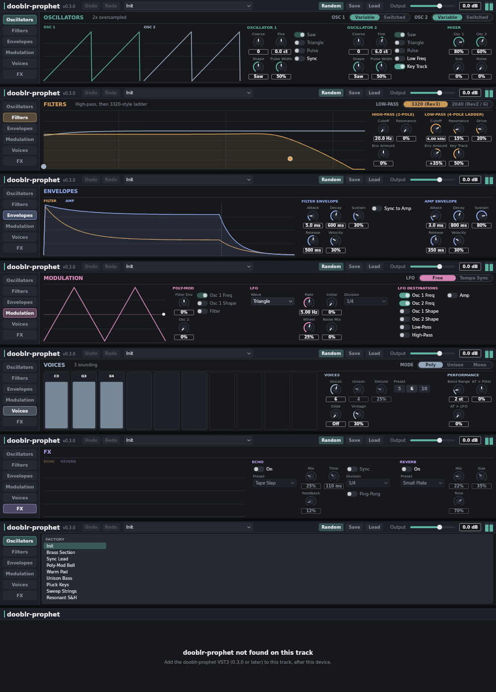

# dooblr-prophet — Max for Live panel

A Max for Live MIDI effect that shows the dooblr-prophet controls inside Live's device view, so you
can play and tweak the synth without opening the plug-in window. It mirrors the editor: same colours,
section names and order, knob style, the six pages (Oscillators, Filters, Envelopes, Modulation,
Voices, FX), the header (preset, Undo/Redo, Random, Save/Load, Output, meter) and the live graphs.
It is two-way: automation, presets, Random and edits made in the plug-in window all show up in the
panel, and edits in the panel go straight to the plug-in.

> **Status: untested in Live.** Only headless checks have run (patcher JSON, cord consistency,
> jsui syntax/ES5 rules, .amxd round trip) and a rendered preview from real link messages
> (`preview.png`). The plug-in side of the link is covered by the plug-in's unit tests.



## Use

1. Needs dooblr-prophet **0.3.0 or later**.
2. Put **dooblr-prophet (M4L)** from *User Library › Presets › MIDI Effects › Max MIDI Effect ›
   dooblr-prophet* on the track, **before** the dooblr-prophet VST3 (MIDI effects always sit before
   the instrument).
3. The panel finds the plug-in, pairs with it and fills in. Until then it says
   *“dooblr-prophet not found on this track”* (or why it cannot connect).

Mouse: drag knobs up/down (Shift for fine), double-click to reset to default, click toggles and
segment buttons, click menus to pick from a list, drag the filter handles (cutoff left/right,
resonance up/down). Save/Load open the plug-in's own file dialogs.

## How it works, and why

Max for Live cannot read or set a third-party VST3's parameters beyond the ones you have
“configured” in Live, and it cannot see text, presets, graphs or the voice state at all. So the
plug-in talks to the panel itself over **OSC on 127.0.0.1 (UDP)**:

- **Local only and dependency-free.** UDP on the loopback address needs nothing beyond stock Max
  objects (`udpsend`/`udpreceive`) and JUCE, and works with Live's sandboxed plug-in host.
- **Exact pairing with the right instance.** Several tracks can each have a synth and a panel. The
  panel picks a random token (1–16000) and sends it to the plug-in *through the track's MIDI*
  as three CCs on channel 16 (CC102 = high 7 bits, CC103 = low 7 bits, CC104 = check), so only the
  plug-in on the same track can hear it. The plug-in then announces its own UDP port to
  `47900 + token`, where only that panel listens. The synth engine ignores these CCs (it only acts on
  CC 1, 64, 120 and 123).
- **The plug-in stays the source of truth.** It sends its parameter list, the page layout (the same
  layout table the editor uses, so the two cannot drift apart), value text, dimming rules, presets
  and graph data. The panel hard-codes nothing but the protocol.

Plug-in ports: first free of 47810–47873. Panel listens on 47900 + token. Messages are `/dp/...`;
see `Source/Link/RemoteLink.h` in the plug-in. Edits use begin/set/end gestures so the plug-in's
Undo/Redo and host automation behave as in the editor. The panel sends `/dp/hello` every second;
the plug-in drops a panel after 5 s of silence and the panel shows *not answering* after 3.5 s.

### Files

- `src/dooblr-prophet.maxpat` — the patch (readable JSON): `midiin → midiout` pass-through,
  `live.thisdevice`, `udpsend`, `udpreceive` and the jsui.
- `src/dooblr-prophet-ui.js` — the whole panel (jsui, ES5, mgraphics drawing).
- `scripts/build.js` — writes `device/dooblr-prophet.amxd` + the js beside it; `--install` copies
  both into `~/Music/Ableton/User Library/Presets/MIDI Effects/Max MIDI Effect/dooblr-prophet/`
  (creates only that folder; Live's preferences are not touched).
- `scripts/check.js` — headless checks; `scripts/amxd.js` — .amxd reader/writer;
  `scripts/preview.js` — renders `preview.png` from link messages captured by the plug-in tests
  (`DOOBLRPROPHET_LINK_DUMP=/tmp/link.json ./Tests/DooblrProphetTests`; needs `@napi-rs/canvas`).

```sh
node scripts/build.js --install
node scripts/check.js device/dooblr-prophet.amxd
```

The device is **unfrozen**: the `.js` must stay next to the `.amxd`. To make a single
self-contained file, open the device in the Max editor and use *Freeze Device*, then save.

## Limits and risks

- Untested in Live (see above). Things that could need fixing on first run:
  - Live must pass the channel-16 CCs from the M4L device through to the VST3 (JUCE exposes MIDI
    CC to VST3 via proxy parameters). If it doesn't, the panel will stay on *connecting…*.
  - The `port` message used to retarget `udpreceive`/`udpsend` at run time.
  - Live may drop a CC repeating the previous value; each new token differs in all three values
    to avoid this.
- The UDP ports are open to any local process (not the network for sending, but `udpreceive`
  binds all interfaces, so macOS may show a firewall prompt — “Deny” is fine).
- Only parameters you have configured in Live show up in Live's automation lanes/undo; the panel
  itself drives every parameter.
- No mouse-wheel control; menus are drawn in the panel instead of native pop-ups.
- Pass-through MIDI and the pairing CCs share the output; pairing bytes are sent on Max's
  scheduler thread so they do not interleave with passing notes.
